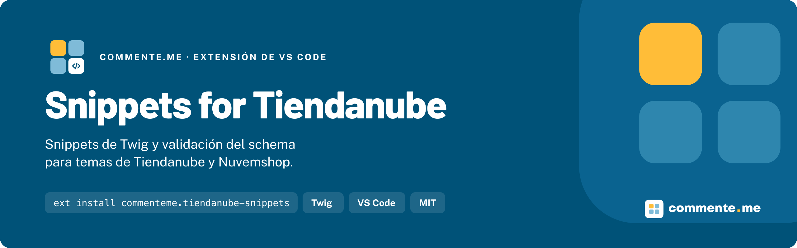

<p align="center">
	
</p>

# Snippets for Tiendanube

**Snippets de Twig y validación del schema para temas de Tiendanube y Nuvemshop.**

[](https://marketplace.visualstudio.com/items?itemName=commenteme.tiendanube-snippets)
[](./LICENSE)

## Instalación

En Quick Open de VS Code (`Cmd/Ctrl + P`):

```
ext install commenteme.tiendanube-snippets
```

Desde el terminal, `code --install-extension commenteme.tiendanube-snippets`. En el Marketplace aparece como
**«Snippets for Tiendanube»**. Requiere VS Code `>= 1.60.0`.

## Uso rápido

En un `sections/*.tpl` de tu tema seccionable, escribe `section-file` y Tab: entra la section completa, con el
recorrido de bloques y el `` con preset. Dentro del schema, `setting-range` inserta un setting válido, y
cualquier error queda subrayado mientras escribes.

## Que incluye

- **Tags y filtros de Twig** propios de Tiendanube y Nuvemshop como snippets, con el enlace a la referencia oficial y
  la marca de si valen para temas seccionables, clásicos o los dos.
- **Sections, bloques, templates y layout** de un tema seccionable (Ipanema), con su ``.
- **Un snippet por cada `setting_type`** del Brand Editor: los 20 tipos de la referencia de schema.
- **Validación del ``** de `sections/` y `blocks/` mientras escribes, con mensajes en español, y de los
  templates JSON de `templates/pages/` y `templates/layout/`.

Funciona en todos los `.tpl`, también en los temas clásicos (FTP). La extensión registra el lenguaje `twig` para
`.tpl` y convive con otras extensiones de Twig.

## Por que existe

Tiendanube publica su documentación para desarrolladores, Agent Skills para editar temas con el CLI y un MCP para
operar la tienda, pero nada para escribir el tema en el editor. Esta extensión cubre eso, como las de VTEX IO, Shopify
y Adobe Commerce de la misma familia. La documentación oficial no tiene licencia abierta ni un esquema publicado: los
datos de `data/twig.json` y los esquemas de `schemas/` están escritos a mano a partir de ella, con descripciones
propias y el enlace a cada página.

## Documentación

### Tags y filtros de Twig

En cualquier `.tpl`, escribe el nombre de la tag (`include`, `embed`, `snippet`, `layout_template`...) o `|` seguido
del nombre del filtro (`|money`, `|static_url`, `|block_attributes`...).

| Prefijo | Que inserta |
| :--- | :--- |
| `set`, `if`, `ifelse`, `for`, `comment` | Las estructuras de Twig de todos los días |
| `snippet`, `include`, `embed`, `block` | Las tres formas de incluir un snippet, con parámetros y slots |
| `snipplet`, `template_content`, `head_content`, `paginate` | Las de los temas clásicos |
| `layout_template`, `page_template_content`, `platform_head_content` | Las del layout de un tema seccionable |
| `\|money`, `\|t`, `\|product_image_url`, `\|resolve_media`... | El filtro con sus parámetros; los tamaños de imagen, en una lista |

### Sections, bloques y templates

| Prefijo | Que inserta |
| :--- | :--- |
| `section-file` | Section completa: lectura de settings, recorrido de bloques y `` con preset |
| `block-file` | Bloque general con `block_attributes` en la raíz y `` |
| `schema-section`, `schema-block` | Solo el `` |
| `section-blocks`, `block-blocks` | El recorrido de bloques de la section o de los hijos de un bloque |
| `block-attributes`, `setting-image` | `block_attributes` y una imagen de `image_picker` con `resolve_media` |
| `setting-header`, `setting-paragraph`, `setting-header-toggle` | Divisores del panel y el toggle que muestra u oculta su grupo |
| `blocks-type`, `blocks-tags`, `preset` | Entradas de `blocks` y de `presets` |
| `template-page` | Template JSON de una página, con `sections` y `order` |
| `layout-file` | Esqueleto de `layouts/layout.tpl` |

### Settings

`setting-` más el tipo, con guion: `setting-text`, `setting-range`, `setting-select`, `setting-alignment`,
`setting-image-picker`, `setting-video-url`, `setting-custom-code`... Cada uno entra con todas las claves que el tipo
necesita (`options` en `select`, `min` y `max` en `range`, los dos ejes en `alignment`).

### Validación

En `sections/*.tpl` y `blocks/*.tpl`:

- **Error**: JSON inválido; setting sin `id` o sin `setting_type`; `header` o `paragraph` sin `content`; `select`,
  `radio` o `alignment` sin `options`; `range` sin `min` y `max`, o con `max` menor que `min`; id repetido; bloque
  aceptado sin `type` ni `tags`.
- **Aviso**: `setting_type` que la referencia no lista (con la sugerencia más cercana); `default` que no está entre
  las opciones; `visible_if` o `disabled_if` que citan un setting que no existe; preset con un setting no declarado.

Las claves que el validador no conoce no son error: la plataforma no publica un esquema y el editor puede aceptar
claves nuevas. Los settings de layout que las sections usan sin declarar (`section_width`, `vertical_padding`,
`horizontal_padding`) tampoco generan aviso. Para apagar la validación, `tiendanubeSnippets.validarSchema: false`.

### Desarrollo

```bash
npm install
npm run check        # genera los snippets, confirma que no cambió nada y corre los tests
npm run empacotar    # genera el .vsix
```

Los archivos de `snippets/` se generan desde `lib/` y `data/twig.json` con `node scripts/gerar.js`: no se editan a
mano.

## Contribuir · Licencia

Abre un PR contra `dev` con Conventional Commits; la promoción a `main` es merge de la rama entera `dev`, con tag de
versión.

[MIT](LICENSE). De dónde salen los datos, en [NOTICE](NOTICE).

---

Hecho por [commente.me](https://www.commente.me) · hablecon@commente.me
